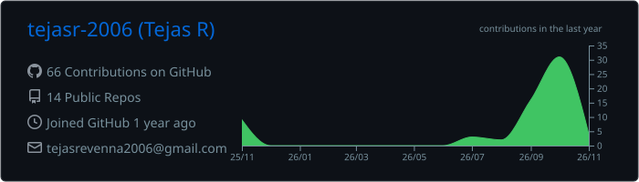
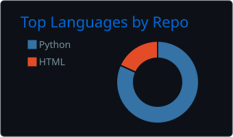
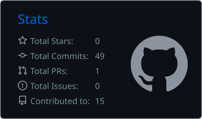

  

<h1 align="center">Hi, I'm Tejas R</h1>

  <strong>Student Developer · Python · AI Applications · Backend Development</strong>

  Building practical software, exploring applied AI, and learning by shipping projects.

  
  
  

---

## About

I'm a student developer interested in building useful applications with Python, backend technologies, and AI. I enjoy working across the full development cycle: understanding a problem, designing an approach, integrating services, and improving the result through testing.

- Developing **JARVIS**, a modular personal AI assistant.
- Building Python applications and REST APIs with **FastAPI**.
- Exploring LLM integrations, AI-assisted workflows, and tool orchestration.
- Interested in backend engineering, application integration, and automation.
- Open to learning opportunities, internships, and collaborative projects.

## Featured Projects

<table>
  <tr>
    <td width="50%" valign="top">
      <h3>JARVIS — Personal AI Assistant</h3>
      
A modular personal assistant built with Python and FastAPI. It coordinates AI reasoning, tools, personal productivity features, and independent application integrations.

      
<strong>Technologies:</strong> Python, FastAPI, Google Gemini, SQLite, HTTPX

      <a href="https://github.com/tejasr-2006/Jarvis">View repository →</a>
    </td>
    <td width="50%" valign="top">
      <h3>Personal AI Email Manager</h3>
      
An AI-assisted email application that connects to Gmail, classifies messages, identifies priorities and action items, detects deadlines, and provides summaries and briefings.

      
<strong>Technologies:</strong> Python, FastAPI, React, Vite, Gmail API, Google Gemini, MongoDB

      <a href="https://github.com/tejasr-2006/personal-ai-email-manager">View repository →</a>
    </td>
  </tr>
  <tr>
    <td width="50%" valign="top">
      <h3>Personal AI Fitness Tracker</h3>
      
A fitness dashboard for tracking workouts, nutrition, water, sleep, body measurements, activity, and progress, with optional Gemini-powered coaching features.

      
<strong>Technologies:</strong> Python, FastAPI, React, Vite, Tailwind CSS, SQLAlchemy, SQLite, PostgreSQL, Gemini

      <a href="https://github.com/tejasr-2006/Personal-AI-Fitness-Tracker">View repository →</a>
    </td>
    <td width="50%" valign="top">
      <h3>Current Learning Focus</h3>
      
Developing stronger foundations in agentic AI, LLM application design, API development, software architecture, and reliable automation.

      
<strong>Interests:</strong> AI agents, backend systems, tool calling, integrations, and developer productivity.

      <a href="https://github.com/tejasr-2006?tab=repositories">Explore all repositories →</a>
    </td>
  </tr>
</table>

## Technical Skills

| Area | Technologies |
|---|---|
| Languages | Python, JavaScript, HTML, CSS |
| Backend & APIs | FastAPI, Flask, REST APIs, Uvicorn |
| Frontend | React, Vite, Tailwind CSS |
| AI | Google Gemini API, LLM integration, AI-assisted workflows |
| Databases | SQLite, PostgreSQL, MongoDB |
| Tools | Git, GitHub, VS Code, Postman |
| Currently exploring | Agentic AI, tool orchestration, automation |

## GitHub Overview

  

  
  

## Contribution Streak

  

## Contribution Snake

  <picture>
    <source media="(prefers-color-scheme: dark)" srcset="https://raw.githubusercontent.com/tejasr-2006/tejasr-2006/output/github-contribution-grid-snake-dark.svg">
    <source media="(prefers-color-scheme: light)" srcset="https://raw.githubusercontent.com/tejasr-2006/tejasr-2006/output/github-contribution-grid-snake.svg">
    
  </picture>

## Coding Profiles

  
  

## Connect

  
  
  

  <em>Building thoughtfully. Learning continuously. Improving with every project.</em>

  

