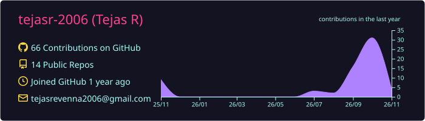

<!-- ========================================================= -->
<!--                    TEJAS R | PROFILE                    -->
<!-- ========================================================= -->

  

<h1 align="center">Hey there, I'm Tejas 👋</h1>

<h3 align="center">AI Developer | Python Developer | Technology Enthusiast</h3>

  

  
  
  

---

## ✨ About Me

<table>
  <tr>
    <td width="68%" valign="middle">
      
Hi, I'm Tejas R! I'm interested in Artificial Intelligence, Python development, automation, and building useful software.

      <ul>
        <li>🤖 Building <strong>JARVIS</strong>, a modular personal AI assistant.</li>
        <li>🐍 Developing backend applications with Python.</li>
        <li>🧠 Exploring LLMs, agentic AI, and tool calling.</li>
        <li>⚡ Interested in AI-powered productivity and automation.</li>
        <li>🚀 Learning by designing, building, testing, and improving projects.</li>
      </ul>
      
<strong>My goal:</strong> Build intelligent systems that make everyday work simpler, smarter, and more productive.

    </td>
    <td width="32%" align="center" valign="middle">
      
    </td>
  </tr>
</table>

---

## 🚀 Featured Projects

<table>
  <tr>
    <td width="50%" valign="top">
      <h3 align="center">🤖 JARVIS</h3>
      
<strong>Personal AI Assistant</strong>

      
A modular personal AI assistant project focused on bringing intelligent reasoning, application integrations, and productivity workflows into one place.

      
<strong>Exploring:</strong> Python, FastAPI, Gemini, tool calling, integrations, and automation.

      
<a href="https://github.com/tejasr-2006/Jarvis">View JARVIS repository ↗</a>

    </td>
    <td width="50%" valign="top">
      <h3 align="center">📧 AI Email Manager</h3>
      
<strong>Intelligent Email Management</strong>

      
A Python application focused on managing email workflows and helping prioritize important messages.

      
<strong>Focus:</strong> Email organization, prioritization, and AI-assisted productivity.

      
<a href="https://github.com/tejasr-2006/personal-ai-email-manager">View Email Manager repository ↗</a>

    </td>
  </tr>
  <tr>
    <td width="50%" valign="top">
      <h3 align="center">🏋️ AI Fitness Manager</h3>
      
<strong>Personal Fitness Management</strong>

      
A fitness application focused on workout tracking and monitoring personal progress.

      
<strong>Focus:</strong> Workout records, fitness data, and progress tracking.

      
<a href="https://github.com/tejasr-2006/Personal-AI-Fitness-Tracker">View Fitness Manager repository ↗</a>

    </td>
    <td width="50%" valign="top">
      <h3 align="center">🧠 Agentic AI</h3>
      
<strong>Learning & Experimentation</strong>

      
Exploring how LLM-powered agents can reason, use tools, and coordinate multi-step workflows.

      
<strong>Topics:</strong> LLMs, agent orchestration, tool calling, and automation.

      
<a href="https://github.com/tejasr-2006?tab=repositories">Explore repositories ↗</a>

    </td>
  </tr>
</table>

---

## 🛠️ Tech Stack & Tools

<h3 align="center">Languages</h3>

  

<h3 align="center">Frameworks & Backend</h3>

  

<h3 align="center">Developer Tools</h3>

  

<h3 align="center">AI & Emerging Technologies</h3>

  
  
  
  

---

## 📊 GitHub Statistics

  
  

---

## 🔥 GitHub Contribution Streak

  

---

## 📈 Contribution Activity

  

---

## 🐍 Contribution Snake

  <picture>
    <source media="(prefers-color-scheme: dark)" srcset="https://raw.githubusercontent.com/tejasr-2006/tejasr-2006/output/github-contribution-grid-snake-dark.svg">
    <source media="(prefers-color-scheme: light)" srcset="https://raw.githubusercontent.com/tejasr-2006/tejasr-2006/output/github-contribution-grid-snake.svg">
    
  </picture>

---

## 💻 Coding Profiles

  
  

---

## 🌐 Let's Connect

  
  
  

💬 Open to collaboration, learning, and interesting software projects!

---

<i>"Building today what I imagine for tomorrow."</i>

  

<h3 align="center">Thanks for visiting my profile! 💗</h3>

Designed with passion by Tejas R

